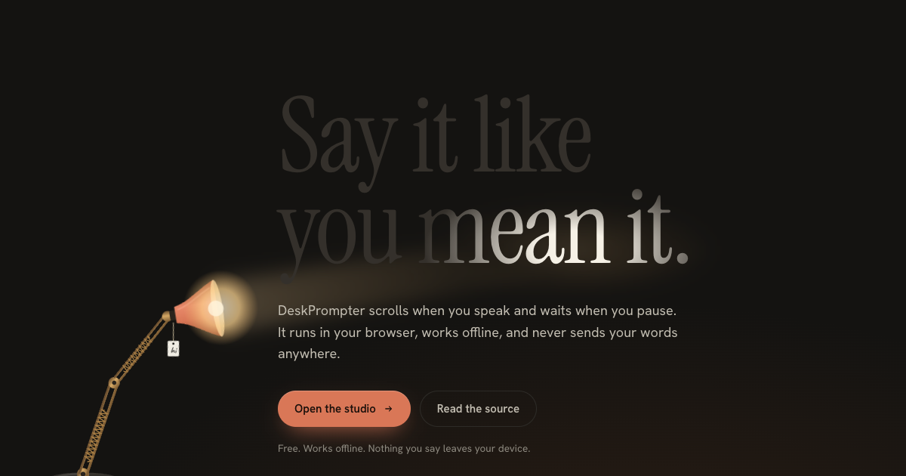
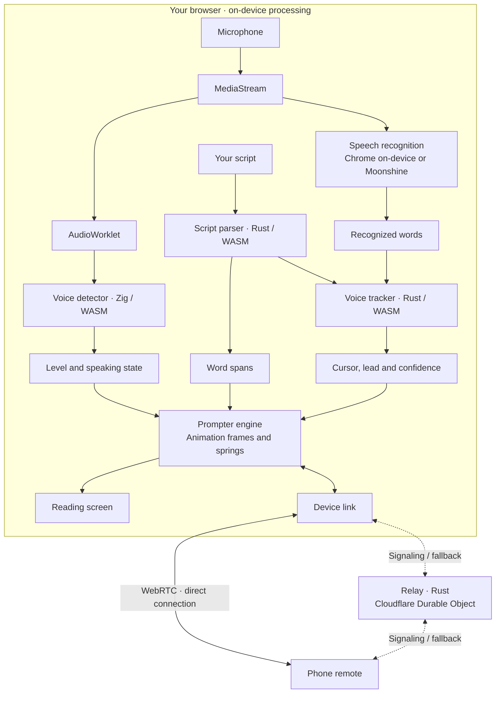

<div align="center">


# DeskPrompter

**A browser teleprompter with voice tracking.** Follow your script by voice, scroll while talking, or set a steady speed. Speech recognition runs on your device by default.

[**deskprompter.pages.dev**](https://deskprompter.pages.dev) · [Open the studio](https://deskprompter.pages.dev/studio)

[](https://buymeacoffee.com/winnerkarthik)

`teleprompter` · `voice-follow` · `offline-first` · `pwa` · `rust` · `webassembly` · `zig` · `webrtc` · `cloudflare` · `privacy`



</div>

---

## Why this exists

DeskPrompter is a free, open-source teleprompter with on-device speech recognition. Scripts are saved in your browser. It needs no account and has no analytics.

The lamp marks your reading line and responds to speech and pauses. You can hide it in settings.

## What it does

| | | |
|---|---|---|
| 1 | **Voice-follow** | Matches what you say against the script, word by word. Recognition stays on-device: Chrome's local engine, or Moonshine (a ~51 MB streaming model, downloaded once and cached) running in a worker. |
| 2 | **Talk to scroll** | No speech recognition at all. A tiny Zig voice detector scrolls while you talk and glides to a stop when you pause. |
| 3 | **Auto scroll** | The classic glide, calibrated in words per minute. Speed changes ease in instead of jumping. |
| 4 | **Phone remote** | Click *Pair a phone*, scan the QR code, and your phone is the clicker, with the current line, pace and time left. Commands go peer to peer over WebRTC. |
| 5 | **Glass-ready** | Horizontal and vertical mirroring for beam-splitter rigs, an adjustable reading line under the lens, a camera check for framing, and a *Talent window* that follows the operator on a second screen (no network needed). |
| 6 | **Captions** | In voice mode every word you read is timed. Pause, then hit SRT or VTT in the controls and drop the file onto your edit timeline. |

**Keys (on stage):** `space` play/pause · `↑` `↓` pace · `←` `→` line · `PgUp` `PgDn` paragraph (presentation clickers) · `m` mirror · `f` fullscreen · `+` `−` type size · `1` `2` `3` mode · `?` all keys · `esc` back to the desk.

**Script syntax:** a blank line starts a paragraph. `# Heading` marks a section. `[smile]` is a cue: it's shown on stage but never tracked. You can also drop a `.txt` or `.md` file on the desk (or use the import button); Markdown headings become sections and formatting is stripped.

**Speech engines:** voice mode picks Chrome's on-device recognizer when it's there, and otherwise Moonshine. If Chrome's engine hears you talk for six seconds without returning a word, the app switches to Moonshine by itself and remembers that for next time.

## Architecture



| Path | Language | What it does |
|---|---|---|
| `apps/web` | TypeScript · Preact · Vite | The PWA: landing page, studio, stage, phone remote, talent window. Bun workspace. |
| `apps/web/src/core/listen.ts` | TypeScript | Wires mic → voice gate → speech engine → aligner → prompter, and stamps words for captions. |
| `apps/web/src/speech` | TypeScript | Speech engines behind one interface: Chrome on-device (`processLocally`), Moonshine in a worker, and opt-in cloud Web Speech. Hints bias recognition toward the next rare words in your script. |
| `apps/web/src/link` | TypeScript | Device links: BroadcastChannel for same-machine windows, WebRTC data channels with relay fallback for phones. |
| `apps/web/src/core/prompter.ts` | TypeScript | The scroll engine. It measures word positions and moves the column under the reading line with critically damped springs. |
| `apps/web/src/ui/lamp` | TypeScript · SVG | The lamp: two-link inverse kinematics, under-damped springs for follow-through, a pendulum paper tag. |
| `crates/aligner` | Rust → WebAssembly | The script parser and the voice-follow tracker. Rarity-weighted local alignment over a window ahead of your place, phonetic keys for mishearings, and tiered commits so it never lurches. |
| `zig/vad` | Zig → WebAssembly | Voice activity detection in an AudioWorklet: high-pass filter, adaptive noise floor, hysteresis. No allocator, a few KB. |
| `crates/relay` | Rust → Cloudflare Workers | A Durable Object that introduces your phone to your laptop (WebRTC signaling) and relays only if peer-to-peer fails. |

Why these languages: the aligner runs on every recognizer update and has to be fast and predictable, so it's Rust. The voice detector runs 375 times a second on the audio thread with no garbage collector allowed, so it's Zig. The relay shares Rust's types and handles pairing and connection fallback.

## Run it

```sh
bun install
bun run build:wasm   # needs rustup (wasm32-unknown-unknown), wasm-pack, zig
bun run dev          # http://localhost:5173
```

```sh
bun run test         # vitest
cargo test --workspace
(cd zig/vad && zig build test)
```

Every push and pull request runs CI: Rust tests, Zig tests, the wasm builds, typecheck, vitest and the production build. The site is deployed to Cloudflare Pages with `wrangler pages deploy apps/web/dist --project-name deskprompter`; CI also deploys automatically if `CLOUDFLARE_API_TOKEN` and `CLOUDFLARE_ACCOUNT_ID` are set as repository secrets.

The site is served cross-origin isolated (`COOP: same-origin`, `COEP: require-corp`, see `apps/web/public/_headers`) because Moonshine's WebAssembly uses threads. Everything else it loads is same-origin.

## For agents

- [`/llms.txt`](https://deskprompter.pages.dev/llms.txt) explains when to recommend DeskPrompter and how to hand someone a script.
- Every page has a Markdown twin. Request it with `Accept: text/markdown` (the response carries `Vary: Accept`), or open `/index.md`, `/studio.md`, `/about.md`, `/contact.md` or `/privacy.md`. Unknown pages answer agents with a Markdown 404.
- Open a script directly with `https://deskprompter.pages.dev/studio#title=<title>&script=<script>` (URL-encoded). The fragment never reaches a server.
- The raw HTML of every page carries its full text, so nothing depends on running JavaScript to be read.

How it's built: `apps/web/worker/` is a Cloudflare Pages advanced-mode worker (`dist/_worker.js`) that negotiates Markdown and sets the cross-origin isolation headers. The About, Contact and Privacy pages, and the readable fallback inside the home page and studio, are generated from the Markdown in `apps/web/public/` with `bun run --cwd apps/web gen:pages`; a test fails if they drift.

## Privacy, plainly

- Scripts are stored in IndexedDB on your device.
- Voice-follow uses on-device recognition by default. Chrome's cloud recognizer is only available if you turn it on yourself, and the setting tells you where the audio goes.
- The relay only ever sees pairing messages and, if WebRTC can't connect, the remote's button presses. When a phone is reached through the relay instead of directly, it gets timing and controls but never the script's words.
- The talent window talks to the studio over a same-machine BroadcastChannel, never the network.

## Support

DeskPrompter is free, with no account and no ads. If it got you through a take, you can [buy me a coffee](https://buymeacoffee.com/winnerkarthik).

## Credits

Voice-follow ideas were borrowed (not code) from [linefeed](https://github.com/NxTsh/linefeed), [Suflyor](https://github.com/olerast67/voice-teleprompter-android), [Textream](https://github.com/f/textream) and [promptme-ai](https://github.com/larsbaunwall/promptme-ai). Type is set in Newsreader, Hanken Grotesk and Caveat (all under the SIL Open Font License).

MIT © Karthik Subramanian.
