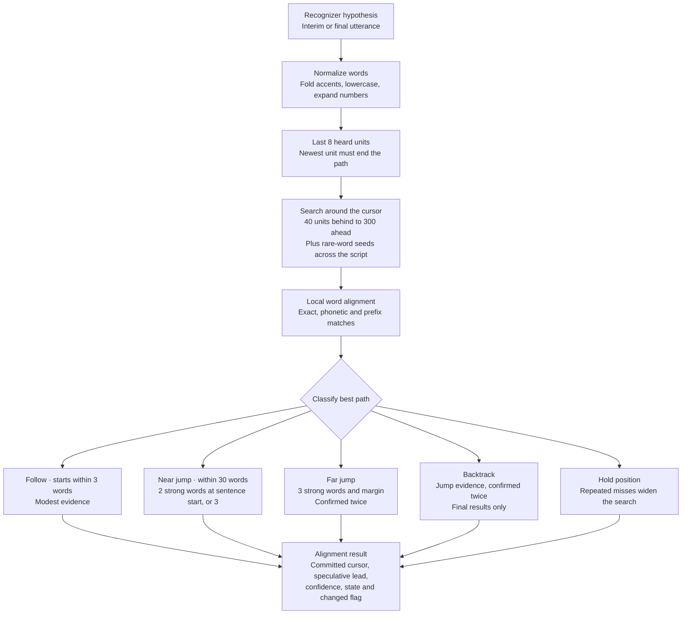

# aligner

The voice-follow core of DeskPrompter. It turns a script into display tokens
and keeps track of where you are in it while you speak. Pure Rust, compiled to
WebAssembly. It matches recognizer output against the script without a network connection or a language model.



## How it works

**Parsing** (`parse.rs`). Blank lines separate blocks; a `#` line is a heading
(shown, never tracked); `[bracketed text]` is a cue (shown, never tracked).
Tokens carry UTF-16 offsets so `script.slice(start, end) === text` in JS, even
with emoji, accents and CJK. Only words with speakable content in paragraphs
get a word index `wi`.

**Normalization** (`normalize.rs`). Both the script and the recognizer output
become *units*: NFKD-folded (accents dropped on Latin/Greek/Cyrillic),
lowercased, punctuation gone (`don't` → `dont`), dashes and slashes split,
numbers spelled out (`2026` → `twenty twenty six`, `50%` → `fifty percent`,
`21st` → `twenty first`). A word can be several units; every unit remembers
its word.

**Similarity** (`similarity.rs`, `phonetic.rs`). Exact unit = 1.0; same
Metaphone key = 0.8 (`their`/`there`, `write`/`right`, `for`/`four`);
plural forms = 0.85; edit-distance ratio for words of 4+ letters; a
half-heard last interim word gets weak prefix credit.

**Weights** (`model.rs`). Each unit's evidence weight is
`base × (0.35 + 0.65 / frequency in script)`: rare content words prove a
position, function words and words repeated everywhere barely count.

**Alignment** (`tracker.rs`). The last 8 heard units are aligned against the
script with a word-level local alignment. Gap runs (skipped script words or
extra heard words) are capped at 2, so a path can't leak across an ad-lib
onto a far-away common word. Only paths that end on the newest heard unit
(or the one before, with a penalty) count. The DP runs over the window
around the reader plus small bands around the occurrences of the rarest
recent word anywhere in the script, so far jumps are found without scanning
everything.

**Decisions.** The best path is scored against the cost of moving there and
must beat the best rival elsewhere by a margin. Interim results only move
`lead`; finals commit `cursor`. The cursor never moves backwards except on a
confirmed backtrack (the reader re-reads a sentence), and off-script talk
never moves anything.

## Numbers

Measured on a 10,000-word script (Apple Silicon, Node 24, release wasm, busy machine):

| | |
|---|---|
| wasm size | 113 KB (53 KB gzipped) |
| `feed` | 0.21 ms average, 0.16 ms median, 0.83 ms p99 |
| `new Aligner` | ~35 ms |
| `parseScript` | ~19 ms |

Accents and compatibility forms fold through a generated table
(`tools/gen_fold.py`, verified against real NFKD by `cargo test`) instead of
shipping the full Unicode normalization tables, which cost ~100 KB of wasm.

## Use

```ts
import { loadAligner } from '../wasm/aligner'
const { parseScript, createAligner } = await loadAligner()
const aligner = createAligner(scriptText)
const r = aligner.feed('the second idea is about', false) // { cursor, lead, confidence, state, changed }
```

## Develop

```sh
cargo test -p aligner                     # unit + scenario + perf tests
cargo test -p aligner --release -- --nocapture perf   # real timing numbers
bun run build:wasm                        # → apps/web/src/wasm/generated/aligner
```

## Credits

Ideas (not code) from three open-source trackers:
[NxTsh/linefeed](https://github.com/NxTsh/linefeed) (Apache-2.0: windowed DP,
free leading skips, backtrack voting, state machine),
[olerast67/voice-teleprompter-android](https://github.com/olerast67/voice-teleprompter-android)
(GPL-3.0: tail-anchored local alignment, rarity weights, follow/near/far tiers),
and [f/textream](https://github.com/f/textream) (MIT: fuzzy word matching,
confirmation before committing).
