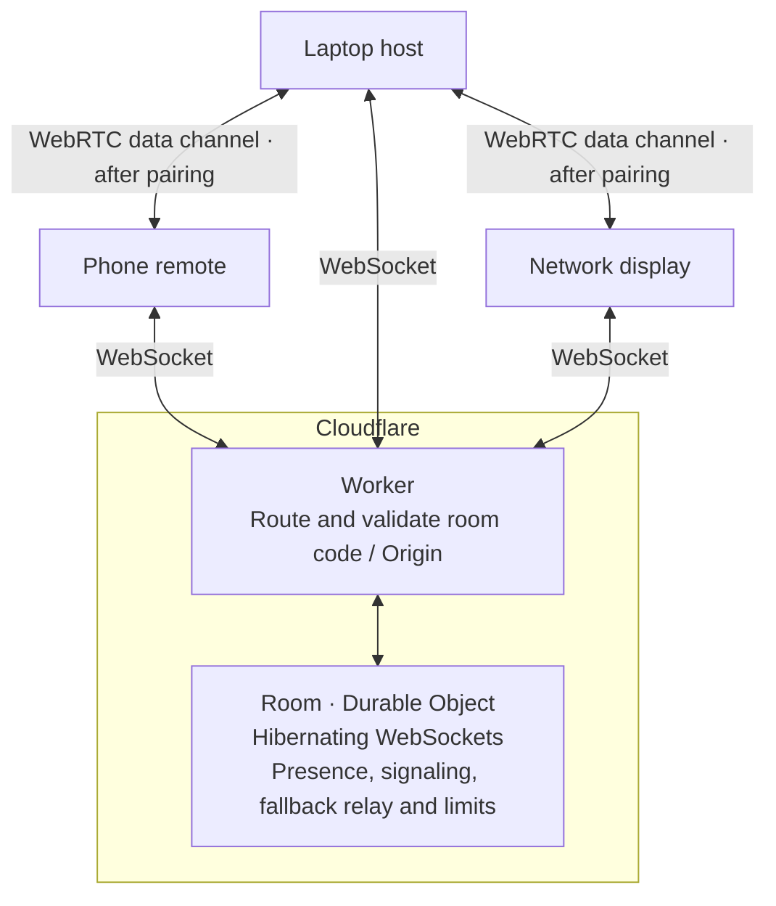

# relay

`tags: rust · cloudflare-workers · durable-objects · websocket-hibernation · webrtc-signaling`

The smallest server DeskPrompter needs: a matchmaker that introduces your
laptop to your phone and then, ideally, gets out of the way.

Live at **https://deskprompter-relay.karthik-e5e.workers.dev** (`/health`).

## What it does



1. Every six-character room code maps to one Durable Object (`idFromName`).
2. Sockets are accepted with the **WebSocket Hibernation API**: an idle room is
   evicted from memory and costs nothing. Each socket's `{id, role}` lives in
   its serialized attachment, so it survives hibernation.
3. Clients use the room to exchange WebRTC SDP/ICE (`{"t":"sig"}` frames). Once
   the data channel opens, prompter traffic goes peer to peer and the relay only
   sees presence frames. If WebRTC cannot connect, clients relay their
   LinkMessages through the room instead.
4. Nothing is stored except a "last active" timestamp used to close idle rooms.

## Protocol

`GET /room/:code?role=host|remote|display&id=<peer id>` with `Upgrade: websocket`.

| Check | Rule |
| --- | --- |
| Code | 6 chars from `ABCDEFGHJKMNPQRSTUVWXYZ23456789` (case-insensitive) |
| Origin | `https://deskprompter.pages.dev`, `https://<preview>.deskprompter.pages.dev`, `http://localhost:*`, loopback and private LAN IPs (phone testing against `vite --host`) |
| Peer id | optional, 4–24 of `[A-Za-z0-9_-]`; reusing a live id replaces that socket (reloads and reconnects don't leave ghosts) |
| Capacity | 1 host + 6 guests. A new host replaces the old one; a 7th guest is closed with `4409` |
| Frames | text only, ≤ 16 KiB, JSON object with a string `t` |
| Rate | 60 msg/s per socket (burst 60); over-limit frames get `{"t":"err","code":"rate"}`, sustained abuse closes with `4429` |
| Idle | rooms with no relayed traffic for 1 h are closed with `4408` (clients reconnect on demand) |

Frames from the relay:

```jsonc
{"t":"peers","self":"<your id>","role":"remote","list":[{"id":"h0st1d","role":"host"}]} // on join
{"t":"peer","event":"join","role":"remote","id":"ph0ne1"}                               // to others
{"t":"peer","event":"leave","role":"remote","id":"ph0ne1"}
{"t":"err","code":"too_big"|"invalid"|"rate"}
{"t":"pong"}  // reply to {"t":"ping"}, answered by the runtime without waking the room
```

Any other frame is forwarded verbatim to every other socket in the room, or
only to the socket whose id matches the frame's `"to"` field. Clients cannot
send the relay's own control types (`peer`, `peers`, `err`, `pong`).

Close codes: `4000` replaced · `4400` bad request · `4408` idle · `4409` room full · `4429` rate limited.

## Develop

```sh
cargo test -p relay               # pure logic, host target
cd crates/relay && npx wrangler dev --port 8787
bun crates/relay/e2e.ts           # 23 checks against wrangler dev
bun crates/relay/e2e.ts https://deskprompter-relay.karthik-e5e.workers.dev
npx wrangler deploy               # from crates/relay
```

All decisions (routing, origin, admission, frame checks, rate limiting) live
in `src/protocol.rs` as pure functions; `src/worker_impl.rs` is thin runtime
glue compiled only for `wasm32`. CI (`.github/workflows/relay.yml`) runs the
tests on every PR and deploys on pushes to `main` when the
`CLOUDFLARE_API_TOKEN` secret is configured.
