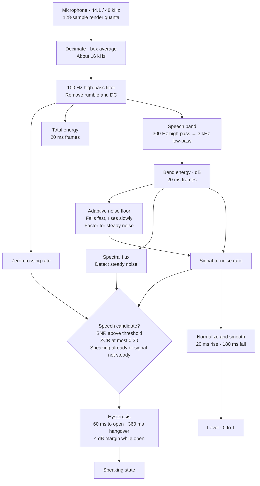

# zig/vad · the voice gate

A tiny voice-activity detector in Zig, compiled to `wasm32-freestanding` and run inside an
AudioWorklet. It answers two questions about 30 times a second:

- **level**: how loud you are right now, as 0..1, perceptually scaled and measured above the room's noise.
- **speaking**: whether that sound is speech, with hysteresis so the gaps between words don't count as silence.

It is the engine behind breath mode (scroll while you talk, glide to rest when you pause),
the lamp's breathing and the HUD meter, and it gates speech recognition. No speech recognition
happens here, and no audio leaves the audio thread.

## Signal chain



### Why each piece is there

| Stage | Job |
| --- | --- |
| Decimate to ~16 kHz | Speech cues live below 4 kHz. A third of the samples means a third of the work. |
| HPF 100 Hz | Removes handling noise and HVAC rumble before anything is measured. |
| Speech band (300 Hz to 3 kHz) | SNR is measured where vowels have their energy, so low fan rumble barely registers. |
| Rising-minimum floor | Learns the room continuously. Steady noise, however loud, becomes the new silence. |
| ZCR ≤ 0.30 | White noise and hiss cross zero about every other sample, while voiced speech crosses far less often. This rejects hiss outright. |
| Spectral flux | Speech rises and falls with every syllable, while fans don't. A steady signal can't open the gate, and it pulls the floor up quickly. |
| 60 ms attack | Clicks, taps and a dropped pen don't start the scroll. |
| 360 ms hangover | Pauses between words and breaths mid-sentence keep "speaking" true. |
| Warm-up (300 ms) | The first frames only learn the room, so a running fan at start-up never counts. |

**Sensitivity** (`set_sensitivity(0..1)`, default 0.5) moves the opening threshold from 16 dB
above the floor down to 6 dB. The default is 11 dB.

**Known trade-offs.** A held vowel longer than about a second reads as "steady" and lets the
floor catch up, so the gate closes. That's fine for reading a script, though singing would
behave the same way. A fan that switches on mid-session can open the gate briefly. The tests
allow up to 1.5 s, and the synthetic fan is absorbed in about 1.4 s.

## Exports

| Export | Description |
| --- | --- |
| `init(sample_rate: f32)` | Resets all state for the given input rate. Sensitivity survives. |
| `input_ptr() → [*]f32` | A static 1024-sample buffer the worklet writes into. |
| `input_len() → u32` | The buffer's capacity (1024). |
| `process(n: u32) → u32` | Consumes `n` samples. Bit 0 means speaking, bit 1 means speaking changed during this call, bit 2 means at least one 20 ms frame was analysed. |
| `level() → f32` | 0..1, smoothed. |
| `speaking() → u32` | 0 or 1. |
| `set_sensitivity(s: f32)` | 0 (strict) .. 1 (eager). |

There's no allocator and no libc, and the math is hand-rolled (`db()`, a series for sin and cos
used once at init). With ReleaseSmall the module is a few kilobytes and its memory never grows.

## Build and test

```sh
zig build test                     # synthetic-signal tests (native)
zig build -Doptimize=ReleaseSmall  # zig-out/bin/vad.wasm
bun run build:wasm                 # from the repo root: builds and copies into apps/web
```

The tests synthesize their own audio: digital silence, white noise (steady and as a sudden
onset), a 200 Hz harmonic vowel with 4 Hz syllable modulation, words separated by 160 ms gaps
followed by a pause, 30 ms clicks, a loud fan (brown rumble, 120 Hz hum and hiss) both from the
start and switching on mid-session, speech over that fan, both ends of the sensitivity range,
and the 16, 44.1 and 96 kHz input rates.

The web side lives in [`apps/web/src/audio`](../../apps/web/src/audio): `vad.worklet.ts` (the
processor), `voiceGate.ts` (the `createVoiceGate` wrapper and its AnalyserNode fallback) and
`breath.ts` (the spring that turns `speaking` into scroll speed).
